# FLOW.md · 一次 FDEP 调用走过的路

> **这份文档讲什么**:从「用户在平台点了某个功能」开始,到「结果回到用户手里」结束,
> 中间每一站发生了什么、每个名词是什么意思、哪些格子最容易填错。
> **配套**:`PLAN.md`(落地计划与实测结果)、`FDEP-AUTHZ-DESIGN.md`(方案本身)。
> **约定**:本文所有路径都相对于**当前工作目录**。

---

## 0. 一句话总览

```
平台验明身份、写下「我要调哪个 app」 → 把这张工单交给流程服务 →
调度节点先问 PDP「这活儿许不许干」 → 许了才交给 Temporal 真的去干 →
干完的结果顺着两条路回到平台
```

**整条链上只有一处是「闸门」**:调度节点里 `cerbosValid` 那一行。
PDP 说不行,活儿就不会被交出去;PDP 说行,或者根本联系不上 PDP,区别只在于
一个是 403 一个是 503 —— 但**都不会**去启动工作流。

---

## 1. 全景图

```mermaid
flowchart TD
    U["调用方<br/>(浏览器 / 上游系统)"] --> P["平台 BPM 层<br/>验身份、组工单"]
    P -->|"PUT /predictions/&#123;prediction_id&#125;<br/>Prefer: respond-sync"| F["流程服务<br/>abc.feg.cn"]
    F -->|"摊开 input 进 shared"| N["调度 Node<br/>(PocketFlow)"]
    N -->|"① 授权判断"| PDP["Cerbos PDP<br/>:3592"]
    PDP -->|"EFFECT_ALLOW / EFFECT_DENY / NO_MATCH<br/>cerbosCallId"| N
    N -->|"② 拒绝:抛 FdepDenied<br/>什么都不启动"| X["异常<br/>403 / 503"]
    N -->|"③ ALLOW 才走这一步"| T["Temporal<br/>namespace / task_queue / workflow"]
    T --> W["app 的业务流程<br/>插件 + 业务逻辑"]
    W --> R1["路 A:HTTP 响应体<br/>(respond-sync)"]
    W --> R2["路 B:webhook 回调<br/>/pocket/flow/&#123;id&#125;/publish"]
    R1 --> P
    R2 --> P
    X --> R1
    X --> R2
```



用文字看,就是六站:

| 站 | 谁 | 干什么 |
|---|---|---|
| 1 | **平台 BPM 层** | 验身份、写下要调哪个 app、发给流程服务 |
| 2 | **流程服务** | 按 `prediction_id` 起一个流程,把工单摊进 `shared` |
| 3 | **调度 Node** | 先问 PDP 允不允许,再决定要不要真的干 |
| 4 | **Cerbos PDP** | 「这个人能不能调这个 app」的裁判 |
| 5 | **Temporal** | 可靠地、跨重启地把活儿交出去做掉 |
| 6 | **回程** | 结果回到平台 |

---

## 2. 第一站:平台 ——「谁在叫我?我要调什么?」

### 2.1 这一站做的三件事

```javascript
outBound.token = {};
var ib = i.payload.inbound;                    // ① 取出业务数据
ib._token_ = {                                 // ② 贴上身份标签
    "sk": outBound.sk,
    "from": i.payload.from,
    "user_id": "guests",
    "roles": ["guests"],
    "email": "guests@feg.cn",
    "now": new Date().toISOString(),
    "attr": {}
};
outBound.share = {                             // ③ 写下工单
    "org": tot,
    "workflowId": outBound.prediction_id,
    "api": api,
    "do": !i.payload.do,
    "inbound": ib
};
```

用大白话说:

- **① 取出业务数据** —— 客户端真正想干的事,原封不动往后传。
- **② 贴上身份标签** —— 这就是 `_token_`。**服务端自己贴的,客户端给的一律作废。**
  这是整套授权能成立的前提:只有服务端知道你是谁。
- **③ 写下工单** —— 这就是 `share`。它说清楚三件事:调哪个 app(`api`)、
  交给哪个 org 去调(`org`)、这次是「查文件」还是「跑业务」(`do`),
  外加跑业务要用的数据(`inbound`)和这次调用的编号(`workflowId`)。

### 2.2 名词:inbound / payload / outBound

| 名词 | 是什么 | 大白话 |
|---|---|---|
| `i.payload` | 进来的那个请求包 | 客户端说的话 |
| `i.payload.inbound` | 请求包里的业务数据 | 「帮我用 systemone 查这个文件」 |
| `ib` | 上面那个业务数据的局部名字 | 同一份东西,换个短名字 |
| `outBound` | 准备发出去的那个包 | 服务端的回话 |
| `share` | `outBound` 里的「工单」 | 要干什么活儿、交给谁干 |
| `_token_` | `outBound` 里的「身份证」 | 你是谁、什么时候来的、从哪来 |

> **`_token_` 为什么塞在 `inbound` 里面?** 因为 `inbound` 是唯一被整条链
> 一路传下去的东西。业务插件在流程的最深处也能看到它,不需要额外的通道。

### 2.3 `_token_` 的六个字段

| 字段 | 是什么 | 谁决定 | 现在的问题 |
|---|---|---|---|
| `sk` | 一段带时间戳的加密串,证明「这次请求是新的」 | 服务端 | 5 分钟内有效,过期就拒 |
| `from` | 来源 IP,是一串 XFF | 服务端 | **客户端可以在前面加内容**,只有最后一段可信 |
| `user_id` | 调用者的身份 | **身份层** | ⚠️ 现在写死 `"guests"`,**后续从系统抓取** |
| `roles` | 调用者有哪些角色 | **身份层** | ⚠️ 现在写死 `["guests"]`,**后续从系统抓取** |
| `email` | 调用者的邮箱 | **身份层** | ⚠️ 现在写死 `"guests@feg.cn"`,**后续从系统抓取** |
| `now` | 服务端当前时间 | 服务端 | 记录用 |
| `attr` | 预留的附加属性 | — | 现在是空的 |

**身份从哪来,不是闸门的事。** 身份层负责把真实的 `user_id` / `roles` / `email`
填进 `_token_`;闸门只负责读。**PDP 认角色,也认 principal 的 id** ——
角色回答「持有这个角色的人能不能调这个 app」,`user_id` 现在还回答
「**这个人**能不能调这个 app」(app 授权就是按 `P.id` 判的)。

> ⚠️ **通用规则按角色,app 授权按 id。** 通用规则用的是
> `FDEP_ADMIN` / `FDEP_DEVELOPER` / `FDEP_AUDITOR`,
> 身份层发出的角色名必须和它们一模一样;app 授权用 `roles: ["*"]`
> (官方文档注 12:忽略角色)加 `P.id`,所以 app 那边不受角色名影响 ——
> 平台发的 `user_id` 是 `guests`,和策略里的 `P.id == "guests"` 对得上。
> 角色名对不上的问题见 §9.1。
> 这份约定写成了测试:`tests/test_fdep_scoped_policies.py::test_the_roles_the_identity_layer_must_emit`。

### 2.4 `share` 的五个字段

| 字段 | 是什么 | 大白话 |
|---|---|---|
| `org` | 这个 org 的配置:`namespace` / `task_queue` / `workflow` | **交给哪个服务实例去干** |
| `workflowId` | 这次调用的编号(= `prediction_id`) | 工单号 |
| `api` | 要调的 app,例如 `systemone.LAYA.Choice` | 调什么 |
| `do` | 这次是查文件还是跑业务 | 怎么调 |
| `inbound` | 业务数据 + `_token_` | 带着什么去 |

### 2.5 ⚠️「do 被取反」—— 整条链上最容易搞错的一格

```javascript
"do": !i.payload.do,
```

**客户端说 `do: true`(跑业务),到 `share` 里就变成了 `false`。**
原因是这个字段的语义在 FDEP 里是「**查文件**」而不是「跑业务」——
`do: true` 读作「只读一份文件,别动手」。

于是三处的解读必须完全一致,否则授权整个反过来:

| 位置 | 代码 | 含义 |
|---|---|---|
| 客户端 → 平台 | `do: true` | 跑业务 |
| 平台 → 流程 | `"do": !i.payload.do` → `false` | 查文件 |
| 调度节点 → PDP | `'read' if do else 'execute'` | `do=False` → **execute** |

**如果第三处写成 `'execute' if do else 'read'`,那么「跑业务」会被当成「查文件」——
读权限就变成了执行权限。** 这一格在 [PLAN.md §4.4](PLAN.md) 里由
`test_do_false_means_execute` 钉死。

### 2.6 为什么要发两个东西:`outBound.token` 和 `outBound.share`

```javascript
outBound.data = {
    "input": {
        "agent": outBound.agent_id,
        "token": JSON.stringify(outBound.token),   // ← 是 "{}"
        "do": true,                                  // ← 写死的 true
        "share": JSON.stringify(outBound.share)      // ← 真正的工单在这里
    },
    "webhook": "http://127.0.0.1:8000/pocket/flow/" + outBound.prediction_id + "/publish"
};
```

- **`share`** —— 真正的工单,序列化成一个 JSON 字符串传过去。
- **`token`** —— 这里传的是 `{}`(空的)。`outBound.token` 上面刚被赋成 `{}`,
  而 `sk` 是单独放进 `_token_` 的。
- **`do`** —— 这一层写死了 `true`,真正的值在 `share.do` 里。

> ⚠️ **这三处是当前最可疑的地方**,见 §9.3。

---

## 3. 第二站:流程服务 —— 把工单变成一个「流程」

### 3.1 `prediction_id` 就是 `workflowId`

```javascript
"workflowId": outBound.prediction_id
```

「预测」是这套系统的业务说法(先预测要发生什么,再真的去做),
「workflow」是执行侧的说法(一个可恢复、可重试的执行)。
**它们是同一个编号**,一个从业务侧来,一个往执行侧去。

它同时是:
- **幂等键** —— 同一个 `workflowId` 提交两次,Temporal 认得出是同一件事,
  不会跑两遍(见 §6.2)。
- **回程地址** —— webhook 地址就是拿它拼出来的。

### 3.2 `Prefer: respond-sync` 与 webhook:两条回程路

| | 路 A:同步 | 路 B:webhook |
|---|---|---|
| 头 / 地址 | `Prefer: respond-sync` | `webhook` 字段 |
| 什么时候拿结果 | HTTP 响应体里直接带回来 | 流程结束后另外 POST 一次回来 |
| 谁在等 | 平台这次请求的线程 | 流程服务 |
| 适合 | 快、要在同一个上下文里拿到结果 | 慢、或者平台这次调用已经返回了 |

**两条路都在跑**,不是二选一:同步的那条给「立刻要结果」的场景,
webhook 那条保证「无论同步那条有没有接住,结果都一定送回来」。

---

## 4. 第三站:调度 Node —— 先问能不能,再干活

### 4.1 PocketFlow 的三段式

```python
class 调度(Node):
    def prep(self, shared):    # ① 从 shared 里把要用的挑出来
        ...
    def exec(self, prep_res):  # ② 真正做事
        ...
    def post(self, shared, prep_res, exec_res):  # ③ 把结果摊回 shared
        shared['output'] = {"data": exec_res}
```

| 段 | 干什么 | 为什么要单独一段 |
|---|---|---|
| `prep` | 从 `shared` 里收集这一站要用的字段 | `exec` 拿到的就是一份干净的小字典,不用到处翻 `shared` |
| `exec` | 干活,返回一个值 | 这一段可以单独重试(`Node(max_retries=...)`) |
| `post` | 把结果写回 `shared` | 流程的输出 = `shared['output']` |

**`shared` 是整条流程共享的一块内存**:所有节点都看得到同一份。
流程服务收到 `input` 之后,第一个节点把它摊进 `shared`,
后面的节点(比如调度)再从中各取所需。

### 4.2 `prep` 收了什么

```python
{
    'api': shared['api'],                  # 调什么
    'do': shared.get('do', True),          # 查文件还是跑业务
    'inbound': shared.get('inbound', None),# 业务数据 + 身份
    'workflowId': shared['workflowId'],    # 工单号
    'org': shared.get('org', None),        # 交给哪个服务实例
    'run_id': (shared.get('token', {})).get('run_id', None),
}
```

> ⚠️ `api` / `inbound` / `workflowId` / `org` 这几个键**不在 `input` 的顶层**——
> 它们在 `input.share` 那个 JSON 字符串里。所以流程里一定还有一个节点,
> 做了类似 `shared.update(json.loads(shared['share']))` 的事。
> **那个节点的合并顺序很重要**,见 §9.3。

### 4.3 `exec` 的五步

```python
namespace  = org["namespace"]      # ① 服务实例的命名空间
task_queue = org["task_queue"]     #    任务队列
workflow   = org["workflow"]       #    工作流名字
kind       = f"{namespace}:{task_queue}:{workflow}"   # ② 拼出 kind
path       = api.rsplit('.', 1)[0]  # ③ api 去掉最后一段 = C4 path
action     = api.rsplit('.', 1)[1]             #    api 的最后一段 = 操作名

requestData = {                    # ④ 真正交给 Temporal 的输入
    "start_to_close_timeout": 600,
    "api": "C4." + api,
    "do": do,
    "inbound": inbound
}

cerbosRes = cerbosValid(run_id, do, inbound, api, kind)   # ⑤ 问 PDP
effect = (cerbosRes.get("actions") or {}).get(action, "EFFECT_DENY")
if effect == 'EFFECT_DENY':
    raise FdepDenied(...)        # 拒绝:抛异常,什么都不启动

result = asyncio.run(execute_temporal_workflow(
    requestData, workflowId, namespace, task_queue, workflow))
return result
```

**顺序就是全部**:授权在启动工作流**之前**。
工作流一旦跑起来,再想停下来,比一开始就不做难得多。

### 4.4 为什么拒绝是「抛异常」而不是「返回一个结果」

```python
if effect == 'EFFECT_DENY':
    return cerbosRes        # ← 旧写法
```

旧写法把「被拒绝」当成「正常跑完了,只是结果里没有东西」。
问题在于:**只看「有没有出错」的调用方,会把一次被拒的调用当成成功。**
一次成功但产出为空的业务调用,和一次被网关挡下来的调用,在返回值上长得一模一样。

所以改成抛异常:

```python
if effect == 'EFFECT_DENY':
    raise FdepDenied(
        status_code,        # 403 = 不许;503 = 判断不了
        reason,             # 人话:为什么
        cerbos_call_id=..., # PDP 审计轨迹的关联键
        result=...,         # PDP 的原话,一样不丢
    )
```

异常里带的东西:

| 字段 | 是什么 | 少了会怎样 |
|---|---|---|
| `status_code` | 403 / 503 | 分不清「没权限」和「不知道」 |
| `reason` | 人话的原因 | 只看到一个笼统的「失败」 |
| `cerbos_call_id` | PDP 的决策编号 | 事后对不上 PDP 的轨迹 |
| `result` | PDP 的原始回答 | 上层读不到 `actions` |

上层要把它变成响应,一行就够:

```python
except FdepDenied as exc:
    return exc.to_payload()      # {"actions": ..., "status": 403, "reason": ...}
```

**注意:抛了异常,`post` 不会执行**,所以 `shared['output']` 是空的 ——
流程的产出就是「这次调用失败了」。结果由流程的错误处理送回去
(同步响应体或 webhook),内容用 `exc.to_payload()`。

---

## 5. 第四站:PDP ——「能不能」是怎么判出来的

### 5.1 一次请求里装着什么

```python
request = {
    "requestId": run_id,
    "principal": {"id": user_id, "roles": roles},
    "resources": [{
        "resource": {
            "kind": "pip.JEV.LAYA",    # namespace.task_queue.workflow
            "id": "systemone.LAYA",   # C4 path(api 去掉最后一段)
        },
        "actions": ["Choice"],        # api 的最后一段 = 操作名
    }],
    "includeMeta": True,
}
```

**没有 scope。** provider 是 kind,app 家族是 id,操作是 action ——
所以每个 provider 一份 policy,没有链。

用 Cerbos 的话说,一次请求问的是:

> **这个主体(principal),能不能对这个东西(resource),做这个动作(action)?**

| 概念 | 在这里是什么 | 大白话 |
|---|---|---|
| `principal` | 谁在调 | 身份 + 角色 + 来处 |
| `principal.roles` | `["guests"]` | **裁判只认这个** |
| `principal.id` | `"guests"` | **谁** —— app 授权按它判(`P.id`) |
| `principal.attr` | IP / 邮箱 / 时间 | 只用于记录,不影响判定 |
| `resource.kind` | `"pip.JEV.LAYA"` | 哪个服务实例(provider) |
| `resource.id` | `"systemone.LAYA"` | **哪个 app**(C4 path) |
| `resource.attr` | **暂时没有** | 控制栏位整个关掉了(`attributes: false`) |
| `action` | `"Choice"` | **哪个操作**(操作名) |

### 5.2 app id 的两段去哪了

FDEP 的 api 是 `systemone.LAYA.Choice`。两段各有去处:

```
systemone.LAYA.Choice
     │            └──► action  = Choice.py      要做哪个操作(py 文件)
     └───────────────► id      = systemone.LAYA 哪一族 app(C4 path,精确匹配)

kind = namespace.task_queue.workflow            哪个服务实例
```

**`kind` 不在 api 里**,它来自 `org`—— 所以两个不同的 org 调同一个 app,
在授权看来是两件不同的事,而且调用方改不了:kind 是服务端从 org 配置算出来的。

### 5.3 三个可能的回答

| 回答 | 意思 | 该回什么 |
|---|---|---|
| `EFFECT_ALLOW` | 规则说行 | 继续 |
| `EFFECT_DENY` | 规则说不行 | **403** |
| `NO_MATCH`(在 `matchedPolicy` 里) | **根本没找到规则** | **403,但原因不同** |
| 收不到回答 | 联系不上 PDP | **503** |

`NO_MATCH` 值得单说:它不是「不允许」,是「**这条链上没有这份策略**」。
多半是 store 里没有这个 kind 的 policy(见 §8.3)或者策略没部署。
**这两种 DENY 必须能分开** —— 一个是「你没权限」,一个是「我们配置错了」。

### 5.4 为什么要 `includeMeta: True`

不带它,响应里只有 `actions`。带上之后才有:

```json
"meta": { "actions": { "Choice": {
"matchedPolicy": "resource.pip.JEV.LAYA.vdefault"}}}
```

`matchedPolicy` 就是「NO_MATCH 的唯一来源」,也是「命中了哪份策略」的唯一来源。
没有它,闸门分不清「策略判了拒绝」和「压根没找到策略」。

### 5.5 `cerbosCallId`

响应顶层还有一个 `cerbosCallId`。它是 **PDP 的审计轨迹和 FDEP 自己的日志之间
唯一的关联键**:FDEP 把它写进自己的日志行,事后就能拿它去 PDP 那边把那条决策找出来。

---

## 6. 第五站:Temporal —— 把活交出去,还能捡回来

### 6.1 三个坐标

```python
execute_temporal_workflow(requestData, workflowId, namespace, task_queue, workflow)
```

| 名词 | 是什么 | 大白话 |
|---|---|---|
| **namespace** | 一批工作流和工人所在的「部门」 | 哪个服务实例 |
| **task_queue** | 工人轮询的队列 | 活儿从哪张桌子被领走 |
| **workflow** | 具体要做的那件事 | 干什么活 |
| **workflowId** | 这次执行的业务编号 | 幂等键 |
| **start_to_close_timeout** | 单次「任务」的超时,这里 600 秒 | 一次动作最多跑 10 分钟 |

**`namespace` + `task_queue` + `workflow` 三者合起来,就是 §5 里那个 kind。**
这不是巧合:kind 的本意就是「同一类东西的不同实例」,
而 Temporal 的这三个坐标正好就是「哪个实例在提供服务」。

### 6.2 为什么 workflowId 就是幂等键

Temporal 收到一个已存在的 `workflowId`,不会重新开一个,而是把那个还在跑的
交回给你。所以:

- 网络重试不会让业务跑两遍;
- 客户端超时后重试,拿到的是同一个执行的结果。

### 6.3 `start_to_close_timeout` 是「一次动作」不是「整件事」

Temporal 把一个工作流切成很多次「任务」(task)。这个超时管的是**单次任务**的上限,
不是整个工作流的上限。所以 600 秒不代表「十分钟内必须干完」。

### 6.4 `C4.` 前缀

```python
"api": "C4." + api,
```

`C4` 是服务提供方的**强制路径依赖规范**:所有对外服务都必须注册在 `C4` 子路径下,
调用方绕不过(实测:`@jev.C4.x` → `C4.C4.x`,前缀是**叠加**不是替换)。

**它不进授权请求。** 它是服务端往 Temporal 转的时候加的路由细节;
授权看的是调用方要的那个 app。

---

## 7. 第六站:结果回来

### 7.1 允许的时候

```
Temporal 工作流跑完
   └─► 流程输出 = shared['output']['data'] = exec_res
         ├─► 路 A:同步 —— PUT 的 HTTP 响应体直接带回去
         └─► 路 B:webhook —— POST http://127.0.0.1:8000/pocket/flow/<prediction_id>/publish
```

### 7.2 拒绝的时候

```
PDP 说不行(或联系不上)
   └─► 抛 FdepDenied —— post 不执行,shared['output'] 是空的
         └─► 流程的错误处理把它变成响应:
               exc.to_payload() = {"actions": {...}, "status": 403, "reason": "...", "cerbosCallId": "..."}
               ├─► 路 A:同步响应体
               └─► 路 B:webhook
```

**拒绝路径没有工作流**,所以没有 Temporal 的部分。
上层读 `data["actions"]` 就知道是被拒了;要区分 403 和 503,
读 `data["status"]`。

---

## 8. 名词总表

### 8.1 FDEP 侧

| 名词 | 是什么 |
|---|---|
| **BPM 层 / 平台** | 收到外部调用、验身份、组装工单的那一层 |
| **inbound** | 客户端送来的业务数据 |
| **outBound** | 服务端准备发出去的包 |
| **`_token_`** | 服务端贴的身份标签(有 `sk`/`user_id`/`roles`/`email`/`from`/`now`) |
| **`sk`** | 带时间戳的加密串,证明这次请求是新的 |
| **share** | 工单:调什么 app、交给谁、是查还是干 |
| **org / tot** | org 的配置:`namespace` / `task_queue` / `workflow` |
| **api** | 要调的 app,形如 `systemone.LAYA.Choice` |
| **do** | 「查文件」为真、「跑业务」为假 —— **在平台层被取反过一次** |
| **prediction_id** | 这次调用的编号,一路当 workflowId 用 |
| **agent** | 发起这次调用的智能体/应用标识 |
| **webhook** | 结果回来的备用地址 |
| **C4.** | 服务提供方的强制路径前缀,只在往 Temporal 转的时候加 |

### 8.2 授权侧

**授权就是三件事:谁(`P.id`)· 哪个 app(`R.id`)· 哪个操作(action)。**

| 名词 | 是什么 |
|---|---|
| **PDP** | Policy Decision Point —— 「能不能」的裁判 |
| **Cerbos** | 做裁判的那个开源引擎 |
| **principal / resource / action** | 谁 / 对什么 / 做什么 |
| **kind** | 哪个服务实例;`namespace.task_queue.workflow` |
| **attr** | 附加属性;**暂时没有** —— `accessMode` 和 `riskLevel` 整个关掉了 |
| **kind** | 资源类别,这里是 app 家族 —— `systemone.LAYA` |
| **EFFECT_ALLOW / EFFECT_DENY** | 允许 / 拒绝 |
| **NO_MATCH** | 压根没找到策略(不是「拒绝」) |
| **matchedPolicy** | 命中的策略;`NO_MATCH` 就写在这里 |
| **matchedScope** | 参与决定的那个 scope(不用 scope 时不会出现) |
| **includeMeta** | 请求里带上它,响应才会给 `matchedPolicy` |
| **cerbosCallId** | 这次决策的编号,PDP 审计轨迹的主键 |
| **validationErrors** | 属性没通过 schema 时的详细原因 |
| **403 / 503** | 不许 / 判断不了 |

### 8.3 不用 scope —— 一个 provider 一份 policy

**没有 scope。** provider 进 kind(`namespace.task_queue.workflow`),
app 家族进 id(C4 path),操作进 action(操作名)。

```
resource.pip.JEV.LAYA.vdefault   ← jev 这一份,规则都在这里
resource.pip.FDEP.SOP.vdefault   ← fdep 这一份
```

一个 provider 一份 policy,没有链、没有层级、没有哪一级会掉链子。

**曾经试过用 scope,代价是实打实的**(实测):

| store 里有什么 | 请求的 scope | 结果 |
|---|---|---|
| 只有叶子 | `pip.JEV.LAYA` | NO_MATCH |
| 叶子 + 根(缺中间层) | `pip.JEV.LAYA` | NO_MATCH |
| 叶子 + 中间层 + 根 | `pip.JEV.LAYA` | ALLOW |

三段路径要四份 policy,两个家族就是八份;而且 PDP 不让删有后代的层
(`400 breaksScopeChain`),想精简也精简不掉。

改用 kind 之后这些全部消失 —— 实测:冒号 kind **不需要祖先 kind**,
不带 scope 的请求由 (kind, "") 那一份应答,就是那一份,没有链。

**原来的 scope 测量记录**(留着当反面教材):

| store 里有什么 | 请求的 scope | 结果 |
|---|---|---|
| 只有叶子 | `pip.JEV.LAYA` | NO_MATCH |
| 叶子 + 根(缺中间层) | `pip.JEV.LAYA` | NO_MATCH |
| 叶子 + 中间层 + 根 | `pip.JEV.LAYA` | ALLOW |

> 实测:先推叶子(链断着)再补中间层,**救不回来**。链必须在推的那一刻就是完整的。
> 一批推送是原子的,所以一次把整条链推上去就够。
> 而现在不用链了 —— 一个 provider 一份,推上去就是完整的。

**app id 的 org 段要说清是哪个 provider。** `pip` 这个命名空间下有两个 provider
(`pip.JEV.LAYA` 和 `pip.FDEP.SOP`),所以 `@pip.…` 说不清是哪一个。两种写法:

| 写法 | org 段 |
|---|---|
| `@jev.systemone.LAYA.Choice` | org 在 FDEP 的 org map 里的键。键是唯一的,所以不歧义 |
| `@pip.JEV.LAYA.systemone.LAYA.Choice` | 完整的 provider 路径 |

**发给 PDP 的 kind 一定是冒号形式** —— PDP 拒绝 scope 里出现竖线,而 kind 接受冒号:

```
scope: does not match regex pattern `^(^$|\.|[0-9a-zA-Z][\w\-]*(\.\w[\w\-]*)*)$`
```

```
app id 的 org 段   jev                ← FDEP 侧(org map 里的键)
发给 PDP 的 kind   pip.JEV.LAYA       ← Cerbos 侧(namespace.task_queue.workflow)
```

**kind 从哪来,仍然是服务端说了算** —— 闸门用 `share.org` 算 kind,
所以 kind 永远和真正干活的 provider 一致,调用方改不了。
app id 用哪种写法,只影响「怎么称呼这个 provider」。

**app 在 `resource.id` 里** —— 那是 Cerbos 给它的一等位置,
而且是精确匹配(`systemoneX` 会被拒,前缀陷阱也挡住了)。
一个 provider 的一份 policy 里,各家族靠 `R.id` 分开 ——
生成器给每条家族规则加上 `R.id == "<C4 path>"`。

**kind 的形状定了:冒号,`namespace.task_queue.workflow`。**
所以每个 provider 一份 policy,新增 provider 走四步:

```
1. 改 pdp-config/orgs.yaml            加一条 org(kind + 它的家族和规则)
2. 跑 gen-scoped-policies.py          生成 policy
3. 跑 push-policies.py                一次发一整批(原子)
4. 跑 gen-scoped-policies.py --verify 查 store 里有没有漏的 provider
```

漏掉任何一步,那个 org 的所有调用都是 `NO_MATCH` → 全拒,
而且报的是「没找到策略」,不是「权限不足」。

**几个 provider 可以共用一层** —— `pip` 同时属于 jev 和 demo:

```
pip.JEV.LAYA.yaml        ← kind pip.JEV.LAYA —— 规则在这一份
pip.FDEP.SOP.yaml        ← kind pip.FDEP.SOP
```

共用那一层是空壳,各自的规则留在各自的叶子上 —— 实测不串味。
生成器遇到「两个 provider 给同一层写不同规则」会**直接报错** ——
Cerbos 一个 kind 只存一份 policy,后者会静默覆盖前者。

### 8.4 时序侧

| 名词 | 是什么 |
|---|---|
| **PocketFlow** | 一个极小的流程框架:节点有 `prep`/`exec`/`post` 三段 |
| **Node** | 流程里的一步 |
| **shared** | 所有节点共享的那块内存 |
| **Flow** | 一串节点按顺序跑 |
| **Temporal** | 可靠执行引擎:工作流、任务队列、命名空间 |
| **workflow / task** | 工作流 / 工作流里的一次「任务」 |
| **worker** | 轮询任务队列、把活儿领走的进程 |
| **idempotency(幂等)** | 同一个 workflowId 提交两次不会跑两遍 |

---

## 9. 这条链上现在会踩的坑

> 前四条是**实测**出来的,不是推测。

### 9.1 ⚠️ 角色名对不上 —— 通用规则还是会被拒

平台发的是:

```javascript
"roles": ["guests"],
```

通用规则写的是 `FDEP_ADMIN` / `FDEP_DEVELOPER` / `FDEP_AUDITOR`。实测:

| 发出去的角色 | 结果 |
|---|---|
| `["guests"]` | **EFFECT_DENY** |
| `["FDEP_ADMIN"]` | EFFECT_ALLOW |

**裁判只认角色。角色名对不上,就是全部拒绝。**

**app 授权已经不受这个影响了** —— 它们按 `P.id` 判(`roles: ["*"]` 忽略角色),
平台发的 `user_id` 是 `guests`,和 `P.id == "guests"` 对得上 ✓。

所以现在:**app 授权通了,通用规则(管理员、开发者、审计员)还差角色名统一。**
两边必须统一 —— 改平台还是改策略,二选一,但不能各叫各的。

### 9.2 ⚠️ 身份现在还是写死的 —— 后续从系统抓取

`user_id` / `roles` / `email` 现在都写死成 `guests`。**后续会改成从系统抓取。**

在那之前,这套授权判的是「一个 guest 能不能调」,不是「张三能不能调」——
身份层接上之前,策略里只有 guest 这一档 id 是有意义的。

接上的时候要确认两件事:

1. **角色名要和策略一致** —— 见 §9.1。裁判只认角色,名字不对就是全拒。
2. **角色不能是空数组** —— 实测 `roles: []` 会让 PDP 直接回 **HTTP 400**
   (那不是决策,是请求不合法)。身份层必须保证至少给一个角色。

这两条都已经写成测试:
`tests/test_fdep_scoped_policies.py::test_the_roles_the_identity_layer_must_emit`
和 `tests/test_fdep_api.py::test_a_call_with_no_roles_is_refused_when_guest_defaulting_is_off`。

### 9.3 ⚠️ `do` 到底传的是哪一个

`input` 顶层写死了 `"do": true`,而 `share.do` 里才是取反后的真值。
`prep` 读的是 `shared['do']`。**两者的合并顺序决定闸门看到哪个。**

- 若看到 `share.do`(取反后的)→ 对 ✓
- 若看到那个写死的 `true` → `accessMode` 永远是 `read` →
  **「跑业务」这条路永远不设防**,而业务其实在跑。

**这一格必须钉死。** 做法:让入口节点的合并顺序固定为「先摊 `share`,再摊 `input` 的其余部分」,
或者干脆把顶层那个 `do` 删掉。

### 9.4 ⚠️ `org` 先解引用后判空

```python
namespace = org["namespace"]   # ← org 是 None 时,这里就炸了
...
if not org:                    # ← 判空写在后面,来不及
    raise ValueError("org 为 None")
```

缺 org 时拿到的是 `TypeError`,不是那句说清楚了的 `ValueError`。
把两个判断挪到最前面就行。

### 9.5 `riskLevel` 写死 `"low"`(暂时整个不需要了)

高风险 app 会被当成低风险 —— `FDEP_DEVELOPER` 那条规则就挡不住它。
这个值应该来自 app 注册表(谁维护、存在哪,还没定)。

### 9.6 `outBound.token` 是空的

`outBound.token = {}` 之后没有再填,`input.token` 传的是 `"{}"`。
于是 `prep` 里的 `run_id` 永远是 `None`,PDP 的 `requestId` 是空的。

实测 PDP 接受空 `requestId`(null / 空串 / 不带都正常应答),
**不会报错**,但审计轨迹里少了「这次调用对应哪个业务」这条线索。

### 9.7 `roles` 为空 → PDP 返回 400

实测:`principal.roles: value is required`。
那不是决策,是请求不合法。身份层必须保证至少给一个角色。

### 9.8 PDP 连不上时,别把它当成 403

参考实现里 PDP 不可达是抛 `RuntimeError`。上层如果一律当成 500,
就把「判断不了」变成了「服务坏了」;如果一律当成 403,
调用方会认为「我就是没权限」然后放弃 —— 一次两秒的 PDP 抖动会变成一整天的业务中断。

**403 是「不许」,503 是「不知道」。这两个必须分开。**

改成抛异常之后,这个区分就变成了异常里的一个数字:

```python
raise FdepDenied(
    status_code,   # 403 = PDP 说不行;503 = PDP 没给出答案
    reason,
    cerbos_call_id=...,
)
```

`fdep_authz/errors.py` 里的 `FdepDenied` 带着 `status_code` 出来;
`fdep_authz/client.py` 里的 `PdpUnavailable` / `PdpRejected` 都是
`RuntimeError` 的子类(所以只认 `except RuntimeError` 的调用方照旧能接),
但它们分得清「连不上」和「回了个看不懂的东西」。

---

## 10. 一次正常调用的时间轴

| 时刻 | 发生什么 | 典型耗时 |
|---|---|---|
| T0 | 平台验完身份,组装 `share` | ms |
| T0+ε | PUT 到流程服务,起一个 flow | 几十 ms |
| T0+ε' | 调度节点 `prep` + `exec`,问 PDP 一次 | **p50 5.8ms / p95 9.8ms**(本机 30 次取样,刚测) |
| T0+ε'' | PDP 按 kind 找策略、求值、回话 | 含在上面 |
| T1 | ALLOW → 提交给 Temporal,worker 领走 | 几十 ms 到几百 ms |
| T1+ | app 的业务逻辑真的跑起来 | 业务决定 |
| T2 | 流程结束,结果同时走同步和 webhook 两条路 | ms |

**授权判断的耗时可以忽略** —— 相对 Temporal 里的业务时间是零头。

**但不要缓存授权结果。** 判断要反映当下的角色;缓存一旦过期,就是绕过闸门。

---

## 11. 相关的文件

| 路径 | 内容 |
|---|---|
| `PLAN.md` | 落地计划 + 实测结果 + 阶段划分 |
| `FDEP-AUTHZ-DESIGN.md` | 方案本身 |
| `src/fdep_authz/` | 闸门参考实现:api 解析、token 组装、PDP 客户端、闸门本体、`FdepDenied`、PocketFlow 的 Node |
| `pdp-config/orgs.yaml` | org 注册表:每个 provider 的 kind 和它提供的 app 家族 |
| `pdp-config/gen-scoped-policies.py` | policy 生成器 + `--verify` |
| `policies/fdep_api/` | 策略:基础一份 + 链上每一层一份 |
| `tests/test_fdep_api.py` | 闸门的测试(含对着线上 PDP 的端到端) |
| `tests/test_fdep_scoped_policies.py` | 生成的 policy 与注册表一致性的测试 |
