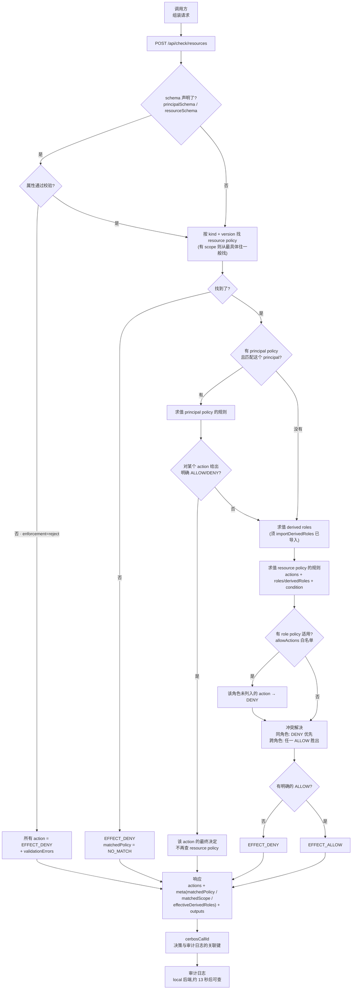

# PDP.md · 从防火墙管理员视角读 Cerbos 策略

> **目的**:把 `Policies.md` 的官方文档阅读笔记,**重新翻译成防火墙管理员的直觉**。
> 目标读者是有防火墙管理经验的人 —— 读完能掌握策略的制订,以及从需求到审计的完整生命周期。
>
> **这里的「防火墙」指应用层的 WAF**,不是网络层的包过滤防火墙。
> 这个区别很关键:WAF 的 From 本来就是**身份**(token / session),
> To 本来就是**URL** —— 而这正好就是 Cerbos 的 principal 和 resource。
>
> **性质**:这是一份**迁移学习记录**。映射关系**逐条确认中**,每一项都标了状态。
> 标 `待确认` 的项是**待确认的猜测**,不是结论。
>
> **依据**:`Policies.md`(逐页读官方文档 0.57.0 的笔记)。
> 本文中每条 Cerbos 侧的陈述都能在 `Policies.md` 里找到出处。

---

## 0. 怎么用这份文档

1. **§1** 先看防火墙管理员已有的直觉 —— 哪些能直接用,哪些完全不能用。
2. **§2** 是核心映射表。**带 `待确认` 的行请重点看** —— 那些是我猜的,可能不准。
3. **§3** 是三处会咬人的地方。**这三条是防火墙思维和 Cerbos 语义真正冲突的地方**,
   也是这份文档存在的理由。
4. **§4** 把一条真实的防火墙规则翻译成 Cerbos,走一遍。
5. **§5** 生命周期对照 —— 日常运维流程怎么走。
6. **§6** 排错对照 —— 症状 → 原因 → 工具。
7. **§8** 是映射确认清单 —— **逐条推进中**。
8. **§9** 走一条真实请求的完整生命周期(全部实测数据),
   包括加上 scope 之后的多一层查找(§9.8)。

---

## 1. 起点:哪些直觉能用,哪些会出错

**应用层 WAF 管理员**脑子里的模型大致是这样:

```
From(源) ──► 管控策略 ──► To(目标)
  用户 / 会话                     URL 路径
  用户组 / 属性                   HTTP method
```

**能直接用的直觉:**

- 默认拒绝(deny-by-default)—— 两边一样
- 「主体 → 目标 → 能做什么动作」的三段式
- 「先建模,再写规则」
- **「例外名单优先于通用规则」**(白名单豁免)

**会用错的直觉 —— 一处:**

| WAF 直觉 | Cerbos 实际 | 后果 |
|---|---|---|
| 规则从上到下,**第一条匹配就赢** | **同一角色内拒绝优先于允许**;跨角色则任一角色的允许胜出 | 规则顺序在 Cerbos 里**不重要**,但「多一条 DENY 就多挡一个人」 |

**本来会咬人、但在 WAF 视角下自然的两处:**

| | 说明 |
|---|---|
| From 是**身份**而不是地址 | WAF 的 From 本来就是 token/session 里的用户 —— **不用改**。IP 只是 `principal.attr` 里的一个字段 |
| To 是**逻辑对象**而不是 IP:port | WAF 的 To 本来就是 URL —— **不用改**。`kind` + `id` 就是「路径前缀 + 具体路径」 |

**最重要的一条:属性(context)是 Cerbos 独有的维度,防火墙里没有对应物。**
WAF 只能按 URL、method、参数、UA、地理判断;Cerbos 还能按「这个人在哪个部门」
「这个资源是不是 published」「现在几点」「IP 在不在公司网段」判断。
**这是引入 Cerbos 的主要理由,不是换皮。**

---

## 2. 映射表

### 2.1 主体侧(From)

| Cerbos | 防火墙直觉 | 实际含义 | 确认 |
|---|---|---|---|
| `principal` | **From(源)** | 发起访问的一方。可能是用户,也可能是服务 | 你提的 |
| `principal.id` | 源 IP | 主体标识。**不一定是 IP** —— 可以是用户 id、服务账号 | 需确认 |
| `principal.roles` | **用户组**(AD/域里的容器) | 主体持有的**一组**角色。**一个人可以同时持有多个**,每个角色独立求值 | ✅ 已确认 |
| `principal.attr` | **无对应** | 附加上下文:部门、租户、IP、邮箱、时间等 | 新概念 |
| `derivedRoles` | **不映射** | 从静态角色 + 请求属性在运行时**推导**出来的角色。必须经 `importDerivedRoles` 导入才生效 | ✅ 已确认(不映射) |
| principal policy | 主机级例外条目 | 针对**特定主体**的覆盖规则,优先于 resource policy | 需确认 |

### 2.2 客体侧(To)

| Cerbos | 防火墙直觉 | 实际含义 | 确认 |
|---|---|---|---|
| `resource` | **To(目标)** | 被保护的对象 | 你提的 |
| `resource.kind` | **不映射** | 「这是一类什么样的资源」。**粒度由应用决定**,同一 kind 下可以有无数实例。可以带 `:` 分层(`album:object`) | ✅ 已确认(不映射) |
| `resource.id` | **不映射** | 具体那个资源的标识。**对 Cerbos 是不透明字符串** —— 除非策略显式比较 `R.id`,否则它不参与任何判断 | ✅ 已确认(不映射) |
| `resource.attr` | **无对应** | 资源自身的属性 | 新概念 |
| `action` | **不映射** | 策略的主要分组维度:「能对它做什么」。可用 `:` 分层(`view:public`),也可以不是 HTTP 动词(`approve`) | ✅ 已确认(不映射) |
| `scope` | **不映射** | 层级化的命名空间:按 `(kind, version, scope)` 定位策略,查找时从最具体往一般走。继承方式由 `scopePermissions` 决定 | ✅ 已确认(不映射) |

### 2.3 规则与策略

| Cerbos | 防火墙直觉 | 实际含义 | 确认 |
|---|---|---|---|
| `rules` | **ACL 条目 / 管控策略** | 一组条件 → 效果的声明 | 你提的 |
| `effect: ALLOW / DENY` | permit / deny | 允许或拒绝 | |
| `condition` | **无对应** | 基于属性的判断。**只能收窄,不能独立成立** | 新概念 |
| `actions` / `roles` | 协议端口 / 源地址组 | 规则的匹配维度 | 需确认 |
| policy | ACL 文件 / ruleset | 一个 kind+version(+scope) 的全部规则 | |
| `variables` / `constants` | **无对应** | 复用的表达式 / 字面量 | 新概念 |
| `importDerivedRoles` / `import` | **安全策略组** | 命名的一组可复用定义(派生角色 / 变量 / 常量),被别的策略按名字引用。**导入是单向、显式的** | ✅ 已确认 |
| `outputs` | **无对应** | 附带说明:这次为什么被拒 | 新概念 |
| `schemas` | **无对应** | 属性的类型约束 | 新概念 |
| role policy | **无对应** | 角色级白名单,**只能收窄** resource policy | 新概念 |

### 2.4 运行时与运维

| Cerbos | 防火墙直觉 | 实际含义 | 确认 |
|---|---|---|---|
| 决策 API | — | 问「能不能做」 | |
| `cerbosCallId` | 流水号 / session id | **决策与审计日志之间的唯一桥梁** | 需确认 |
| 审计日志 | 会话日志 / 日志服务器 | 记的是**决定**,不是流量 | 需确认 |
| `includeMeta` | `show` 命令行 | 看到「为什么」 | 需确认 |
| `matchedPolicy` | `show rule` 命中哪条 | 产生决定的策略标识 | |
| `effectiveDerivedRoles` | 动态组成员 | 这次实际激活了哪些派生角色 | |
| `cerbos compile` | 配置检查 / 语法检查 | **编译 + 跑测试套件** | 需确认 |
| 测试套件 `*_test.yaml` | **无对应** | 策略的行为断言 | 新概念 |
| 策略仓库 | 设备配置备份 | git 仓库 + CI 编译 | 需确认 |
| Admin API | 设备配置推送接口 | 增删改查策略和 schema | 需确认 |

---

## 3. 三处会咬人的地方

这一节是本文的核心。**只读映射表会写出「看起来对但语义错」的策略。**

在 WAF 视角下,原来列的三处只有**第一处(规则顺序)真的咬人**;
另两处(From 是身份、To 是逻辑对象)在 WAF 语境下本来就是对的。

### 3.1 规则顺序不重要,但「多一条 DENY 就多挡一个人」

**防火墙**:ACL 从上往下第一条匹配就赢,顺序即语义。

**Cerbos**(`Policies.md` §2 冲突解决):

| 范围 | 规则 |
|---|---|
| **同一角色、同一 action** | ALLOW 和 DENY 都匹配 → **DENY**。拒绝永远优先 |
| **跨角色** | 只要有一个角色求值出 ALLOW(且该角色没有 DENY)→ **整体 ALLOW** |

**翻译成防火墙的话**:

> 防火墙是「先命中先赢」;Cerbos 是「同角色内拒绝优先,跨角色取并集」。

**这带来两个实践后果:**

1. **规则顺序不用 care,但 DENY 的作用范围要精确。** 在 Cerbos 里加一条
   `roles: ["*"]` 的 DENY,会挡住**所有**持有那个角色的主体 —— 相当于在防火墙
   顶部插一条 `deny any any`,但**它不能被下面任何一条 permit 覆盖**(同角色内)。
2. **多角色的主体权限是并集。** 页面给的例子:principal 持有 `["admin", "user"]`,
   规则只允许 `admin` 做 `delete` → 结果 **ALLOW**。因为 `admin` 有 allow、
   `user` 没有 deny。

> 页面明确说这个设计的意图:**避免 admin 因为恰好还挂着一个低权限角色而被锁死。**

**给防火墙管理员的一句话**:你不能靠「把 deny 写在 allow 后面」来绕过它;
你也不能靠「我只有一条 deny 规则」来精确表达「只挡某个人」——
要挡特定人,得用那个人的角色,或者用 condition。

### 3.2 From 是身份,IP 只是个属性

**WAF**:From 本来就是用户/会话 —— **这一条在 WAF 视角下不用改**。

**Cerbos**:`principal.id` 是主体标识(用户 id、服务账号),
`principal.roles` 是它持有的角色集合。**IP 只是 `principal.attr` 里的一个普通属性。**

所以「限制某个网段」在 Cerbos 里是**一个 condition**,不是身份:

```yaml
condition:
  match:
    expr: P.attr.ip_address.inIPAddrRange("10.20.0.0/16")
```

这和防火墙的差别是实质性的:

| | 防火墙 | Cerbos |
|---|---|---|
| 源 IP 是身份吗 | **是** —— 匹配规则时就是它 | 否,是属性 |
| 换台机器同一用户 | **换了身份**,策略要改 | 同一主体,IP 变了但身份没变 |

**实践含义**:如果照搬防火墙,把 IP 写进 `principal.id`,那么
「同一个人从家里 vs 公司访问」会变成两个主体,审计轨迹也对不上。

### 3.3 To 是逻辑对象,不是 IP:port

**WAF**:To 本来就是 URL —— **这一条在 WAF 视角下也不用改**。

**Cerbos**:resource = `(kind, id)`。**kind 的粒度由应用决定**,官方例子说
「在 HR 应用里,resource 可以粗到整份员工记录,细到记录里的单个字段」。

**翻译**:防火墙的「目标服务 + 端口」在这里被拆成三样东西:

| 防火墙 | Cerbos |
|---|---|
| 目标服务类型 | `resource.kind` |
| 目标端口 | `action` |
| 具体那台机器 | `resource.id` —— **是业务对象的标识,不是 IP** |

**实践含义**:Cerbos 的策略**不关心资源在哪台机器上**。同一套策略在测试环境和
生产环境一样用 —— 这也是 `Policies.md` 说 `$ref` 要用 `cerbos:///` 绝对 URL 的原因:
**策略要在不同环境之间可移植。**

---

## 4. 一次完整的翻译

拿一条真实的防火墙规则走一遍。

**防火墙(原样)**:

```
!  10.20.0.0/16  →  192.168.1.10:443  (deny)
   10.20.0.0/16  →  192.168.1.10:443  (permit)
```

读法:公司网段可以访问发票系统的 HTTPS 端口,其他人不许。

**翻译成 Cerbos**:

第一步 —— 拆出「什么资源、什么动作」。资源是「发票」,动作是「查看」:

```yaml
apiVersion: api.cerbos.dev/v1
resourcePolicy:
  resource: "invoice"
  version: default
  rules:
    - name: accounting-can-view-invoices
      actions: ["view"]
      effect: EFFECT_ALLOW
      roles: ["ACCOUNTANT"]
```

第二步 —— 把「网段」变成 condition。源 IP 从**身份**降级成**属性**:

```yaml
    - name: accounting-can-view-invoices-from-office-network
      actions: ["view"]
      effect: EFFECT_ALLOW
      roles: ["ACCOUNTANT"]
      condition:
        match:
          expr: P.attr.ip_address.inIPAddrRange("10.20.0.0/16")
```

第三步 —— 补上「只有 ACCOUNTANT 能看」。**默认拒绝已经覆盖了这一点**,
但防火墙习惯显式写 deny;在 Cerbos 里**不要加 catch-all DENY**(见 §3.1 和 §5)。

**翻译后的对照**:

| 防火墙 | Cerbos |
|---|---|
| 源 IP `10.20.0.0/16` | `roles: ["ACCOUNTANT"]` + `P.attr.ip_address.inIPAddrRange(...)` |
| 目标端口 443 | `actions: ["view"]` |
| 目标 IP 192.168.1.10 | `resource.kind: "invoice"` + `resource.id: <发票 id>` |
| deny any | 不需要(默认拒绝) |

**注意一个翻译上的选择**:我加了 `roles: ["ACCOUNTANT"]`,而防火墙那条规则
**只按网段判断,没按人**。

严格对应的翻译应该是:

```yaml
    - actions: ["view"]
      effect: EFFECT_ALLOW
      roles: ["*"]
      condition:
        match:
          expr: P.attr.ip_address.inIPAddrRange("10.20.0.0/16")
```

**但这个翻译在防火墙语境下是对的,在 Cerbos 语境下有个问题**:
`roles: ["*"]` 意味着**任何主体**,只要 IP 在网段内,就能看所有 invoice。
防火墙的网段本来就是「这一整段机器都归我们管」,所以这在防火墙里没问题。

**这就是「建模」这一步的价值** —— 官方把四种建模方式并列
(action-led / role-led / attribute-led / hybrid),
每种写法解决不同的问题,选哪种是**建模决定**,不是翻译结果。

---

## 5. 生命周期对照

防火墙管理员熟悉的那套流程,换成 Cerbos 是什么样。

| 阶段 | 防火墙 | Cerbos |
|---|---|---|
| **接需求** | 「财务部要能访问发票系统」 | 同 |
| **建模** | 定目标服务、端口、地址组 | 定 `kind`、`action`、`role`、属性 |
| **写策略** | 写 ACL 条目 | 写 `rules` |
| **同行评审** | 变更单 + 有人签字看 diff | policy review + `cerbos compile` |
| **变更前验证** | 找个测试客户端打一发,看计数器 | **写一条测试用例**,`compile` 会跑 |
| **部署** | reload / commit 到设备 | `POST /admin/policy`(或 `PUT`) |
| **确认生效** | 看计数器涨了 | `GET /admin/policies` 看清单 |
| **观察** | 会话日志 / 抓包 | 决策日志(`?lookup=<cerbosCallId>`) |
| **排错** | 看计数器、看会话 | `includeMeta` 看 `matchedPolicy` |
| **回滚** | reload 旧配置 | `POST /admin/policy/disable`,或 delete + revision |
| **交接** | 配置备份 | git 仓库 |

### 5.1 三个流程差异

**① 验证发生在部署之前,而且是「行为断言」不是「看一眼」。**

防火墙的验证是「打一发看通不通」;Cerbos 的测试套件是**声明式的期望**:

```yaml
tests:
  - name: 会计可以从办公室网段查看发票
    input:
      principals: [accountant_alice]
      resources: [invoice_001]
      actions: [view]
    expected:
      - principal: accountant_alice
        resource: invoice_001
        actions:
          view: EFFECT_ALLOW
```

而且**没写出来的就是期望 DENY** —— `input` 里列了但 `expected` 里没列的组合,
所有 action 都期望 DENY。所以测试文件可以只写放行项。

**② 「锁死自己」的担心,在 Cerbos 里的对应风险不是配置,而是「多写了一条 catch-all DENY」。**

防火墙管理员最怕的是 `permit` 写错把自己关在外面。Cerbos 里默认拒绝意味着
**最坏情况是全拒绝**,不会误放行。但反过来 —— 本项目实测踩到过:
**一条省略 `roles` 的规则会让整个 policy 失效**,所有请求落到默认拒绝,
而 policy 在管理接口里看起来「部署成功了」。

> 正确写法是 `roles: ["*"]`(显式匹配所有人)。这条在 `Policies.md` §5 的
> resource policy 标注 (12) 里有:「特殊值 `*` 可以在求值这条规则时 disregard roles」。

**③ 审计记的是「决定」,不是「流量」。**

防火墙日志记的是连接(谁连了谁、传了多少字节);Cerbos 决策日志记的是
**授权决定**(谁被允许或拒绝了做什么、命中了哪条策略)。

这意味着 Cerbos 的日志**不能**用来做流量分析,但**能**回答「这个人为什么没权限」
—— 这是防火墙日志做不到的。

---

## 6. 排错对照

官方给的「意外 DENY / 意外 ALLOW」清单(`Policies.md` §16),翻成防火墙语言:

| 症状 | Cerbos 的原因 | 怎么确认 |
|---|---|---|
| 该放行的被拒了 | **没有匹配的策略**(kind + version 对不上) | `includeMeta` 看 `matchedPolicy` 在不在 |
| | **缺派生角色导入** | `effectiveDerivedRoles` 是空的 |
| | **condition 求值为 false** | 看请求里的属性名/类型;用 REPL 单测表达式 |
| | **显式 DENY 匹配了** | 同角色同 action,拒绝优先 |
| | **角色不匹配** | 角色**大小写敏感**、必须精确匹配、**不能填派生角色名** |
| 不该放行的放行了 | **通配符过宽** | `actions: ['**']` / `roles: ['**']` 匹配范围超预期 |
| | **派生角色条件过松** | 检查 condition |

**防火墙管理员最熟悉的一条 —— 「规则没命中」—— 在 Cerbos 里有三个不同的原因**
(没策略 / 没导入 / 角色不匹配),而 `includeMeta` 能一次区分开:
`matchedPolicy` 有没有、`effectiveDerivedRoles` 有没有。

**注意 `**` 和 `*` 是两个不同的东西。** `Policies.md` §16 的「意外 ALLOW」那节写的是
`**`(两个星号),而 action 通配符是 `*`(一个星号,恰好一层)。

---

## 7. 本项目的具体落点

| 概念 | 本项目的东西 |
|---|---|
| resource | kind `basicResource` / `fdepApi`,id 是业务对象标识 |
| action | `read` / `create` / `update` / `delete`;FDEP 那边是**操作名**(api id 的末段) |
| scope | FDEP 那边是 **provider**(org)——「哪个 Service Provider 实例在提供这个服务」 |
| principal | id = 用户 id,roles = 角色集合,attr = IP / 邮箱 / 时间 |
| condition | `R.attr.ownerId == P.id` 这类 |
| audit | PDP 决策日志(`local` 后端可查)+ FDEP 侧调用轨迹,靠 `cerbosCallId` 关联 |
| compile 的替代 | 没有 cerbos 二进制,用 Python harness 把**同一份** `*_test.yaml` 对着线上 PDP 跑 |
| REPL 的替代 | 同上,逐条 case 跑 |

---

## 8. 映射确认清单

这些是我推断的,需要你确认或纠正。**按重要性排序**,逐条处理中。

**进度**:5 / 16 已确认(第 1、2、3、4、5 项)。

| # | 我的映射 | 我的理由 | 状态 |
|---|---|---|---|
| 1 | `principal.roles` ≈ **用户组** | 贴在主体上的无语义标签集、静态、来自目录/IdP。**但多角色取并集**,防火墙的多组按顺序先匹配 | ✅ |
| 2 | `scope` ≈ ? | **决定不映射** —— 继承方式可配、链上不能缺层,防火墙没有等价物 | ✅ 不映射 |
| 3 | `action` ≈ ? | **决定不映射** —— HTTP method 太窄:action 可用 `:` 分层、也可以是业务动词;而且 action 在 Cerbos 里是策略主轴 | ✅ 不映射 |
| 4 | `resource.kind` ≈ ? | **决定不映射** —— 用 Cerbos 自己的术语(`kind` = 一族资源,`id` = 其中一个),不加 URL 类比 | ✅ 不映射 |
| 5 | `derivedRoles` ≈ ? | **决定不映射** —— 机制太 Cerbos 特有(import 才生效、条件求值时机、parentRoles 可为 `*`) | ✅ 不映射 |
| 6 | `principal policy` ≈ 主机级例外条目 | 都针对单个主体、优先于通用规则 | |
| 7 | `role policy` ≈ ? | **防火墙里没有对应物** —— 它是「角色级白名单,只能收窄」 | |
| 8 | `variables` / `constants` ≈ **安全策略组** | 都是「命名的一组定义,被按名字引用」。区别:Cerbos 的变量是**表达式**,常量才是字面量 | ✅ |
| 9 | `schemas` ≈ ? | 防火墙没有属性类型约束 | |
| 10 | `outputs` ≈ ? | 防火墙没有「附带拒绝原因」的机制 | |
| 11 | 决策日志 ≈ 会话日志 | 都是事后追溯,但记的东西完全不同(决定 vs 流量) | |
| 12 | `cerbosCallId` ≈ 流水号 | 都是把一次操作和日志条目对起来的键 | |
| 13 | `includeMeta` ≈ `show` 命令行 | 都是问「为什么」 | |
| 14 | `cerbos compile` ≈ 配置检查 | 但它**同时跑测试**,更接近「变更前的自动验收」 | |
| 15 | 策略仓库 ≈ 设备配置备份 | 但它带版本、CI 编译,是「变更管控」而不只是「备份」 | |
| 16 | Admin API ≈ 配置推送接口 | 但它也能**读回**和**删除**,更接近配置管理 | |

### 8.1 我认为**不该**映射的东西

| Cerbos | 为什么没有防火墙对应物 |
|---|---|
| `scope` | 继承方式可配(`scopePermissions`)、链上不能缺层 —— WAF 的规则集分层没有这些约束 |
| `action` | HTTP method 太窄:Cerbos 的 action 能用 `:` 分层、能是业务动词,而且它是策略的主轴 |
| `resource.kind` / `resource.id` | 这两个是资源寻址的两个维度,防火墙没有对应的拆分方式 |
| `derivedRoles` | 依赖「import 才生效」这套机制,类比会掩盖真正需要注意的地方 |
| `condition` | 防火墙只能按 IP/端口/协议匹配;条件判断是逻辑层的 |
| `principal.attr` / `resource.attr` | 防火墙没有「对象的业务属性」概念 |
| `requestContext.annotations` | 只做关联、不参与决策,类似防火墙日志的附加标签 |
| `outputs` | 附带说明,不影响决定 |
| `schemas` | 类型约束 |

**这五个是 Cerbos 相对防火墙的净增能力。** 如果迁移后觉得「防火墙那套用不上」,
大概率是这五个没用起来 —— 而不是映射错了。

---

---

## 9. 一次请求的完整生命周期

这一节把 §3 的映射落到**一条真实的请求**上。所有响应都是对着线上 PDP
(`http://10.17.1.201:3592`) 实测抓的,不是回忆的。

### 9.0 流程图



**纯文本版**(不依赖 mermaid 渲染):

```
调用方
  │  组装: principal(id, roles, attr) + resource(kind, id, attr) + actions
  ▼
PDP 收到请求
  │
  ├─ ① schema 校验 ──── 不通过 ──► 所有 action = DENY + validationErrors
  │      (principalSchema / resourceSchema,ignoreWhen 可豁免某些 action)
  │
  ├─ ② 按 kind+version 找 policy(有 scope:具体→一般)
  │      找不到 ──► DENY,matchedPolicy = NO_MATCH
  │
  ├─ ③ principal policy 优先 ──► 明确决定就到此为止
  │
  ├─ ④ 求值 derived roles
  │
  ├─ ⑤ 求值 resource policy 的规则
  │      (actions 匹配 + roles/derivedRoles 命中 + condition 为 true)
  │
  ├─ ⑥ role policy 收窄(allowActions 白名单)
  │
  ├─ ⑦ 冲突解决:同角色 DENY 优先;跨角色任一 ALLOW 胜出
  │
  └─ ⑧ 没有任何明确 ALLOW → DENY
       ▼
响应:actions + meta + outputs
       ▼
cerbosCallId ──► 审计日志(约 13 秒后可查)
```

### 9.1 阶段 ①:调用方组装请求

实测的请求体(alice 读自己的文档):

```json
{
  "requestId": "trace-A",
  "includeMeta": true,
  "principal": {
    "id": "alice",
    "roles": ["USER"],
    "policyVersion": "default",
    "attr": { "department": "marketing" }
  },
  "resources": [
    {
      "resource": {
        "kind": "basicResource",
        "id": "doc-1",
        "policyVersion": "default",
        "attr": { "ownerId": "alice", "isPublished": false }
      },
      "actions": ["read"]
    }
  ],
  "requestContext": {
    "annotations": { "trace_id": "t-42", "app_id": "systemone" }
  }
}
```

**每个字段对应防火墙语言里的什么:**

| 字段 | 防火墙语言 | 概念说明 |
|---|---|---|
| `principal.id` | 源标识 | **主体标识,不一定是 IP**。防火墙的 From 是 IP,这里是用户 id |
| `principal.roles` | 源地址组 | **一组**角色标签。`alice` 可以同时有 `["USER","ADMIN"]`,两个角色独立求值 |
| `principal.attr` | — | 主体的额外上下文。`department` 是业务属性,防火墙里没有 |
| `resource.kind` | 目标服务类型 | 「这是一类什么样的资源」。策略按它查找 |
| `resource.id` | 目标 IP | **业务对象的标识**,不是网络位置 |
| `resource.attr` | — | 资源自身的属性。`ownerId`/`isPublished` 是策略要判断的东西 |
| `actions` | 目标端口 | **逻辑操作名**。`read` 不是 443 |
| `policyVersion` | 策略版本 | `default` 是兜底版本。策略按 `(kind, version)` 唯一定位 |
| `requestContext.annotations` | 日志附加标签 | **只做关联,不影响决策**。实测原样进审计轨迹 |
| `includeMeta` | `show` 命令行 | 要不要返回「为什么」 |
| `requestId` | 流水号 | 调用方自己的关联 id,原样进审计轨迹 |

**防火墙管理员最容易搞错的两点**(与 §3.2 / §3.3 对应):

- `principal.id` **不是 IP**。IP 要放在 `principal.attr` 里。
- `resource.id` **不是 IP**。它是业务对象的 id,而 `kind` 才是「哪一类」。

### 9.2 阶段 ②:schema 校验

实测:**属性不合法时,所有 action 直接 DENY,并附带 validationErrors**。

```json
// 请求:isPublished 传了字符串 "true"(schema 要求 boolean)
"actions": { "read": "EFFECT_DENY" },
"validationErrors": [
  {
    "path": "/isPublished",
    "message": "expected boolean, but got string",
    "source": "SOURCE_RESOURCE"
  }
],
"meta": { "actions": { "read": { "matchedPolicy": "resource.basicResource.vdefault" } } }
```

三个概念:

- **`source`** —— `SOURCE_PRINCIPAL` 还是 `SOURCE_RESOURCE`,告诉你**是哪一侧**的 attr 不合法。
  同一个路径可以两侧都报。
- **`path`** —— JSON Pointer 形式(`/isPublished`),直接指向出问题的属性。
- **`ignoreWhen`** —— 按 action 豁免校验。实测:`create` 时资源还没有 owner 和发布状态,
  所以 `ignoreWhen: {actions: [create]}` 让它跳过校验:

  ```json
  // 请求:attr 只有 ownerId,缺 isPublished —— 但 action 是 create
  "actions": { "create": "EFFECT_ALLOW" }   // 通过
  ```

  **同一个策略文件里,`create` 通过而 `read` 被拒** —— 因为豁免是按 action 的。

⚠️ **注意 `matchedPolicy` 仍然是 `resource.basicResource.vdefault`** —— 策略**匹配上了**,
是 schema 先把它拦下的。**这两件事要分开看**:策略匹配失败是 `NO_MATCH`,
schema 拦截是「匹配了但拒绝」。

### 9.3 阶段 ③:策略查找

按 `(kind, version)` 找。有 scope 时从最具体往一般走:

```
scope = a.b.c  →  查 a.b.c → a.b → a → 无 scope
```

**这一阶段失败的表现是 `matchedPolicy: NO_MATCH`。**

> ⚠️ **这一条是本次实测当场撞上的。** 追踪开始时,**所有请求都 DENY、
> `matchedPolicy` 全是 `NO_MATCH`** —— 因为**PDP 的 store 是空的**。
> 而 `GET /_cerbos/health` 依然返回 `{"status":"SERVING"}`。
>
> **策略集为空 ≠ PDP 坏了。** 健康检查只说进程活着,不说策略在不在。
> 唯一可靠的检查是 `GET /admin/policies` 看清单。
>
> 这和 §3.1 是同一件事的另一面:**默认拒绝机制在故障时表现为「全部拒绝」,
> 而不是「报错」**。所以 FDEP 侧必须区分 403(真的没权限)和 503(判断不了)。

### 9.4 阶段 ④-⑦:规则求值与冲突解决

用实测的两个场景说明。

**场景 H2 —— 跨角色取并集。** 策略:

```yaml
- name: admin-may-do-anything
  actions: ["*"]
  roles: ["ADMIN"]
  effect: EFFECT_ALLOW

- name: user-may-delete-owned
  actions: ["delete"]
  roles: ["USER"]
  effect: EFFECT_ALLOW
  condition:
    match:
      expr: R.attr.ownerId == P.id
```

| 请求 | 结果 | 说明 |
|---|---|---|
| `roles: ["USER"]`,文档属于 bob | **DENY** | USER 的 condition 不成立,没有规则命中 → 默认拒绝 |
| `roles: ["USER","ADMIN"]`,文档属于 bob | **ALLOW** | USER 拒绝,但 **ADMIN 允许** → 跨角色取并集,ADMIN 胜出 |

**这就是「admin 不会被低权限角色锁死」的机制。**

**场景 I1 —— 同角色拒绝优先。** 加一条:

```yaml
- name: no-delete-during-freeze
  actions: ["delete"]
  roles: ["USER"]
  effect: EFFECT_DENY
  condition:
    match:
      expr: R.attr.frozen == true
```

| 请求 | 结果 | 说明 |
|---|---|---|
| `roles: ["USER"]`,自己的文档,`frozen: true` | **DENY** | USER 的 ALLOW 命中了,但 USER 的 DENY 也命中了 → **同角色内拒绝优先** |
| `roles: ["USER","ADMIN"]`,自己的文档,`frozen: true` | **ALLOW** | DENY 规则只写了 `roles: ["USER"]`,**对 ADMIN 不生效** → ADMIN 的 ALLOW 胜出 |

> **这两行放在一起看,是防火墙思维最容易错的地方:**
>
> | | 防火墙(ACL) | Cerbos |
> |---|---|---|
> | USER 允许 + USER 拒绝 | 后写的赢(顺序) | **拒绝赢** |
> | USER 拒绝 + ADMIN 允许 | 顺序决定 | **允许赢**(跨角色并集) |
> | ADMIN 允许 + 仅对 USER 的拒绝 | 顺序决定 | **允许赢**(拒绝不作用于 ADMIN) |
>
> **「谁赢」由「哪个角色命中了哪条规则」决定,不由规则写在哪一行决定。**

### 9.5 阶段 ⑧:最终 effect

完整的实测结果汇总(全部对着线上 PDP,同一份 `basicResource` 策略):

| # | 场景 | actions | effect | 原因 | matchedPolicy | validationErrors |
|---|---|---|---|---|---|---|
| A | alice 读自己的文档(未发布) | `read` | **ALLOW** | `user-may-read-published-or-owned` 的 `ownerId == P.id` 成立 | `resource.basicResource.vdefault` | — |
| B | bob 读 alice 的文档(未发布) | `read` | **DENY** | 两个 condition 分支都不成立 → 无规则命中 → 默认拒绝 | `resource.basicResource.vdefault` | — |
| C | alice 删 bob 的文档 | `delete` | **DENY** | `ownerId == P.id` 不成立 → 默认拒绝 | `resource.basicResource.vdefault` | — |
| D | alice(USER+ADMIN)读已发布文档 | `read` | **ALLOW** | ADMIN 的 `actions: ["*"]` 命中;USER 的 `isPublished == true` 也命中 | `resource.basicResource.vdefault` | — |
| E | `isPublished` 传字符串 | `read` | **DENY** | **schema 拦截**,策略还没开始求值 | `resource.basicResource.vdefault` | `expected boolean, but got string`(SOURCE_RESOURCE) |
| F | `create`,attr 缺 `isPublished` | `create` | **ALLOW** | `ignoreWhen` 豁免了 create 的资源校验 | `resource.basicResource.vdefault` | — |
| G | 策略集为空 | `read` | **DENY** | **没有匹配的策略** | **`NO_MATCH`** | — |

**从这张表能读出四种 DENY,它们在响应里的样子完全不同:**

| 拒绝类型 | effect | matchedPolicy | validationErrors |
|---|---|---|---|
| 策略没匹配上 | DENY | **`NO_MATCH`** | — |
| schema 拦截 | DENY | 正常的策略 id | **有** |
| condition 不成立(默认拒绝) | DENY | 正常的策略 id | — |
| 规则命中了 DENY | DENY | 正常的策略 id | — |

> ⚠️ **最后两种在响应里长得一模一样。** 都只有 `EFFECT_DENY` + 正常的 `matchedPolicy`。
> 要区分它们,得看策略本身,或者用 `outputs`(见下)。

### 9.6 阶段 ⑨:outputs —— 附带说明,不是解释

实测的 outputs(场景 H1):

```json
"outputs": [
  {
    "src": "resource.demoApp.vdefault#user-may-delete-owned",
    "val": { "reason": "not the owner", "who": "alice" },
    "action": "delete"
  }
]
```

三个概念:

- **`src`** —— `策略id#规则名`。**规则名在这里才有用** —— 没有 `name` 的规则,`src` 就少一半可读性。
  (本项目的 `basicResource.yaml` 顶部就注明:「规则名是 `src` 里可读的部分」)
- **`ruleActivated` vs `conditionNotMet`** —— 规则的 condition 成立还是不成立。
  实测同一个规则的两个分支:
  - `ownerId == P.id` 成立 → `{"reason": "owner may delete"}`
  - 不成立 → `{"reason": "not the owner"}`
- **`action`** —— 这个 output 是为哪个 action 产生的。

> ⚠️ **outputs 不解释最终 effect。** 实测场景 I1:
>
> | | 值 |
> |---|---|
> | outputs 说 | `{"reason": "owner may delete"}` ← 听起来是允许 |
> | 实际 effect | **`EFFECT_DENY`** ← 因为另一条 DENY 规则赢了 |
>
> 原因是那条 DENY 规则**没有配 output**,所以 outputs 里没有任何东西解释这个 DENY。
>
> **结论:outputs 是「逐条规则的自述」,不是「判决书」。**
> 要解释最终结果,得看 `matchedPolicy` + 策略本身。

### 9.7 阶段 ⑩:审计轨迹

实测抓到的完整一条(等约 13 秒后可见):

```json
{
  "callId": "01M6505N8B2ERXPM4TK3GX44GR",
  "timestamp": "2026-10-29T23:33:23.869509352Z",
  "peer": {
    "address": "10.17.1.94:44479",
    "userAgent": "python-httpx/0.28.1",
    "forwardedFor": "10.17.1.94"
  },
  "checkResources": {
    "inputs": [{
      "requestId": "trace-A",
      "resource": {"kind":"basicResource","policyVersion":"default","id":"doc-1",
                   "attr":{"isPublished":false,"ownerId":"alice"}},
      "principal": {"id":"alice","policyVersion":"default","roles":["USER"],
                    "attr":{"department":"marketing"}},
      "actions": ["read"]
    }],
    "outputs": [{
      "requestId": "trace-A",
      "resourceId": "doc-1",
      "actions": {"read": {"effect":"EFFECT_ALLOW",
                           "policy":"resource.basicResource.vdefault"}}
    }]
  },
  "auditTrail": {
    "effectivePolicies": {
      "resource.basicResource.vdefault": {
        "attributes": {"driver":"sqlite3","update_ts":"2026-10-29T23:33:19Z"}
      }
    }
  },
  "requestContext": {"annotations": {"app_id":"systemone","trace_id":"t-42"}},
  "policySource": {"database": {"driver":"DRIVER_SQLITE3"}}
}
```

**与防火墙日志的对照:**

| 轨迹字段 | 防火墙会话日志里的对应 |
|---|---|
| `callId` | 流水号 —— **决策与日志条目的关联键** |
| `timestamp` | 时间戳 |
| `peer` | 会话的源/目的地址与端口 |
| `checkResources.inputs` | **防火墙没有** —— 它记的是「请求了什么」,不记「授权时看到的完整上下文」 |
| `checkResources.outputs` | 防火墙记的是「放行了多少字节」,这里记的是「授权结果 + 命中哪条策略」 |
| `auditTrail.effectivePolicies` | **防火墙没有** —— 命中的策略及其版本、更新时间 |
| `requestContext.annotations` | 日志的附加标签(trace id、app id) |
| `policySource` | **防火墙没有** —— 策略来自哪里(这里是 `database` + `sqlite3`) |

**两个实测的坑:**

1. **约 13 秒后才可见**(`local` 后端先缓冲再提交)。**读轨迹要轮询**,读一次就断言「查不到」得到的是错的结论。
2. **`effectivePolicies` 为空是正常的** —— 没有策略命中时它是 `{}`。**「空」和「记录缺失」是两件事**,
   统计时不能混。

### 9.8 加上 scope 之后:多了一层查找

前八节是**没有 scope** 的情况。加上 scope 之后,策略查找变成一条链,
而这条链的行为**比直觉严格**。实测(基础 policy + `scope: jev` 的 policy):

```
请求带 scope=jev
   ↓
查 resource.fdepApi.vdefault/jev     ← 有就用它
   ↓ 没有
查 resource.fdepApi.vdefault          ← 基础 policy
   ↓
```

| 请求 | 结果 | matchedPolicy |
|---|---|---|
| scope=`jev`(有这份 policy) | 按 jev 的规则判 | `resource.fdepApi.vdefault/jev` |
| scope=`other`(**没有**这份 policy) | **NO_MATCH** | **`NO_MATCH`** |
| scope=`jev.child`(jev 有,jev.child 没有) | **NO_MATCH** | **`NO_MATCH`** |
| scope=`jev`,某角色(基础 ALLOW / scoped DENY) | **DENY** | `.../jev` |

**两个要点:**

**① 请求的 scope 必须有对应的 policy。** 基础 policy **不是兜底** ——
`scope=other` 时基础那份根本没被咨询。这和「往上走找」的直觉相反。

**② scope 存在时,更具体的赢。** 同一个角色在基础里 ALLOW、在 scoped 里 DENY → DENY。

**这意味着:新增一个 provider 却忘了加 scoped policy,那个 provider 的所有调用都会被拒**,
而且报错是 `NO_MATCH`(「没找到策略」),不是「权限不足」——
两者在运维上的处理方式完全不同。

缓解手段是引擎配置 `engine.lenientScopeSearch: true`(缺失叶子 scope 时继续往上找),
但**store 里已存在的 scope 链仍必须完整**。

### 9.9 响应怎么被消费

决策拿到之后,**应用侧要自己决定怎么用**:

| 结果 | 应用该做什么 |
|---|---|
| `EFFECT_ALLOW` | 继续业务流程 |
| `EFFECT_DENY` + `matchedPolicy` 正常 | 拒绝;要用 `outputs` 给出可解释的原因 |
| `EFFECT_DENY` + `NO_MATCH` | **这可能是故障,不是权限问题** —— 策略集空了或版本对不上 |
| `EFFECT_DENY` + `validationErrors` | 调用方传错了属性 —— 是**调用方的 bug**,不是权限 |
| PDP 不可达 | **拒绝**,但回 503 而不是 403,让调用方知道可以重试 |

> **最后两行是 FDEP 改造时的核心要求**(见 `FDEP-AUTHZ-DESIGN.md` §7.3)。
> 响应里「拒绝」有两种完全不同的原因,混在一起会让排查变得极其困难。

---

## 10. 下一步

这份文档的映射还要继续确认。建议的顺序:

1. **先确认 §3 的三条** —— 这三条是语义冲突,不是词汇对应,错了会写出「看起来对但语义错」的策略。
2. **再确认 §8 的前三项**(roles / scope / action)—— 它们决定策略怎么组织。
3. 然后补一节 **「用 Cerbos 重做本项目现有策略」** —— 把 `basicResource.yaml` 按防火墙语言
   反向讲一遍,确认映射在实际用例里站得住。

**在 §3 和 §8 前三项确认之前,这份文档的映射部分请当作草稿。**
